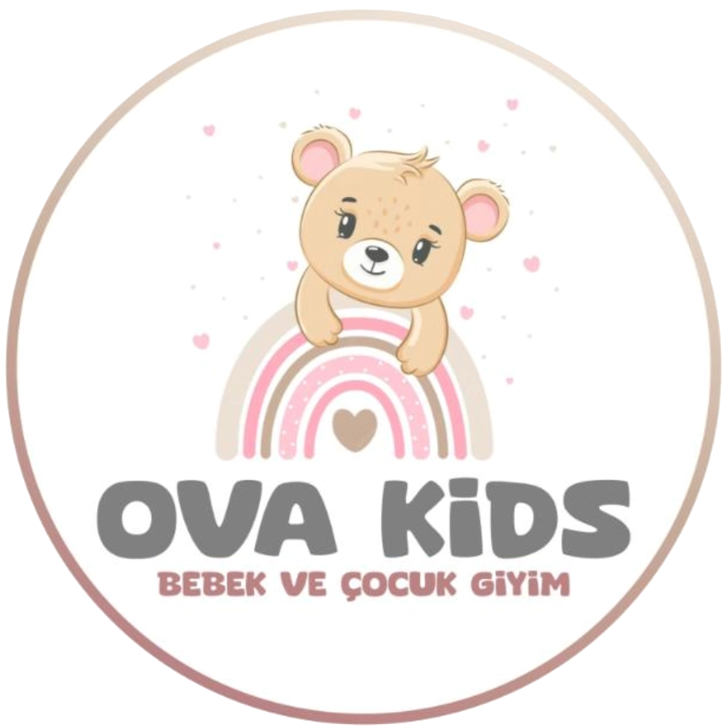
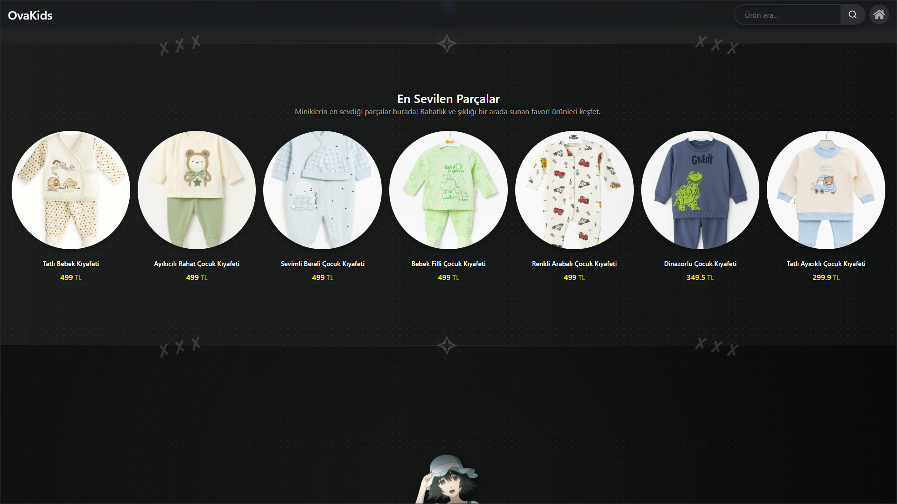
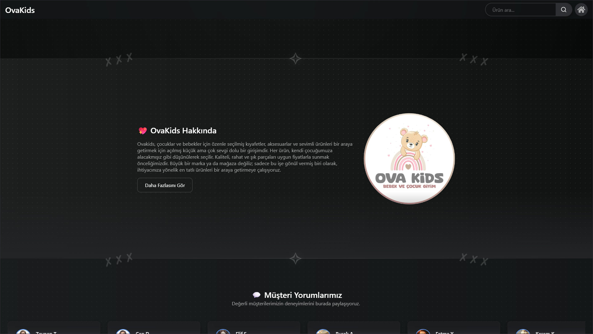
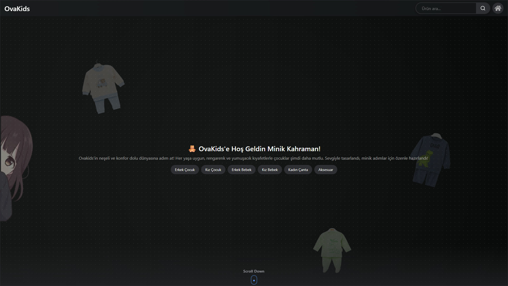
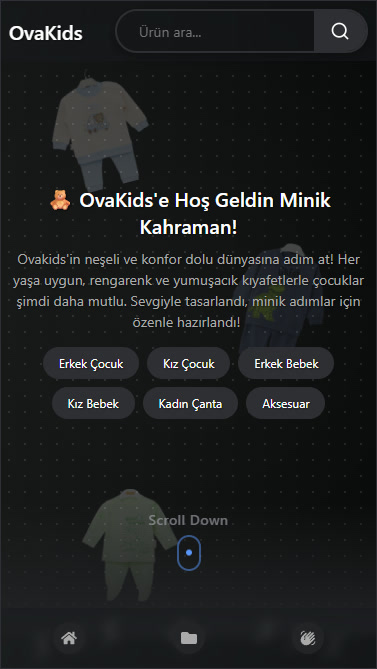
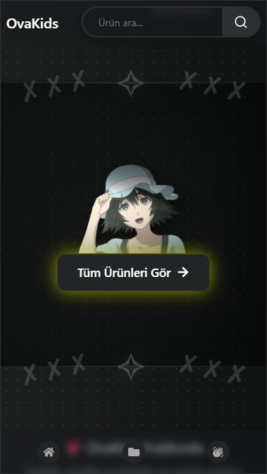

<a href="README.md">
  
</a>
<a href="README-TR.md">
  
</a>

  <br />
  <br />

<div align="center">
  
  <br />
  <br />

  <p>
     Çocuk ve bebek giyimi ile aksesuarları için bir vitrin sitesi.
  </p>


  <p>
    <a href="#demo">Demo</a> •
    <a href="#about">Hakkında</a> •
    <a href="#features">Özellikler</a> •
    <a href="#tech">Teknolojiler</a> •
    <a href="#setup">Kurulum</a> •
    <a href="#gallery">Galeri</a> •
    <a href="#license">Lisans</a>
  </p>

  <br />
  <br />
</div>

## <a id="demo"></a> 📷 Demo

- [https://xkintaro.github.io/ovakids/](https://xkintaro.github.io/ovakids/)

## <a id="about"></a> 📋 Hakkında

**OvaKids**, çocuk ve bebek giyimi ile aksesuarları satan bir mağaza için hazırlanmış bir vitrin sitesidir. Bu siteyi bir komşumun mağazası için hızlı bir demo olarak tek günde hazırladım. Proje sonrasında devam etmedi, bu yüzden burada arşiv olarak tutuyorum.

Site, öne çıkan ürünleri ana sayfada listeler ve ziyaretçilerin tüm kataloğa kategoriye göre ya da arama yaparak göz atmasını sağlar. Ürün, kategori ve yorum verileri `public/data` klasöründeki JSON dosyalarından okunur. Böylece içerik koda dokunmadan değiştirilebilir. Arayüz Türkçedir.

## <a id="features"></a> ✨ Özellikler

- **Öne çıkan ürünler**: Seçilen ürünler ana sayfada gösterilir.
- **Kategori filtresi**: Kataloğa erkek çocuk, kız çocuk, erkek bebek, kız bebek, kadın çanta ve aksesuar gibi kategorilere göre göz atın.
- **Anlık arama**: Yazdıkça ürün başlıkları ve açıklamaları arasında arama yapın.
- **Müşteri yorumları**: Müşteri yorumlarını yıldızlı puanlarıyla birlikte okuyun.
- **Mobil menü**: Küçük ekranlarda alt menü, ana sayfaya, ürünlere ve hakkında bölümüne hızlı erişim sağlar.

## <a id="tech"></a> 🛠️ Teknolojiler

`React` · `Vite` · `CSS` · `React Icons` · `Kintaro UI`

## <a id="setup"></a> 🚀 Kurulum

### Gereksinimler

- **Node.js**

### Adım Adım Kurulum

1. **Depoyu klonlayın**

   ```bash
   git clone https://github.com/xkintaro/ovakids.git
   cd ovakids
   ```

2. **Bağımlılıkları yükleyin**

   ```bash
   npm install
   ```

   Windows'ta bunun yerine `install-dependencies.bat` dosyasını çalıştırabilirsiniz.

3. **Geliştirme sunucusunu başlatın**

   ```bash
   npm run dev
   ```

   Windows'ta bunun yerine `run.bat` dosyasını çalıştırabilirsiniz.

Uygulamayı şu adreste açın: [http://localhost:5173/ovakids/](http://localhost:5173/ovakids/).

## <a id="gallery"></a> 🖼️ Galeri







<p align="center">&nbsp;&nbsp;</p>

## <a id="license"></a> 📄 Lisans

Bu proje MIT Lisansı altında lisanslanmıştır. Detaylar için [LICENSE](LICENSE) dosyasına bakabilirsiniz.

#

<p align="center">
  <sub>❤️ Developed by "Mustafa TAŞAL" (kintaro)</sub>
</p>
