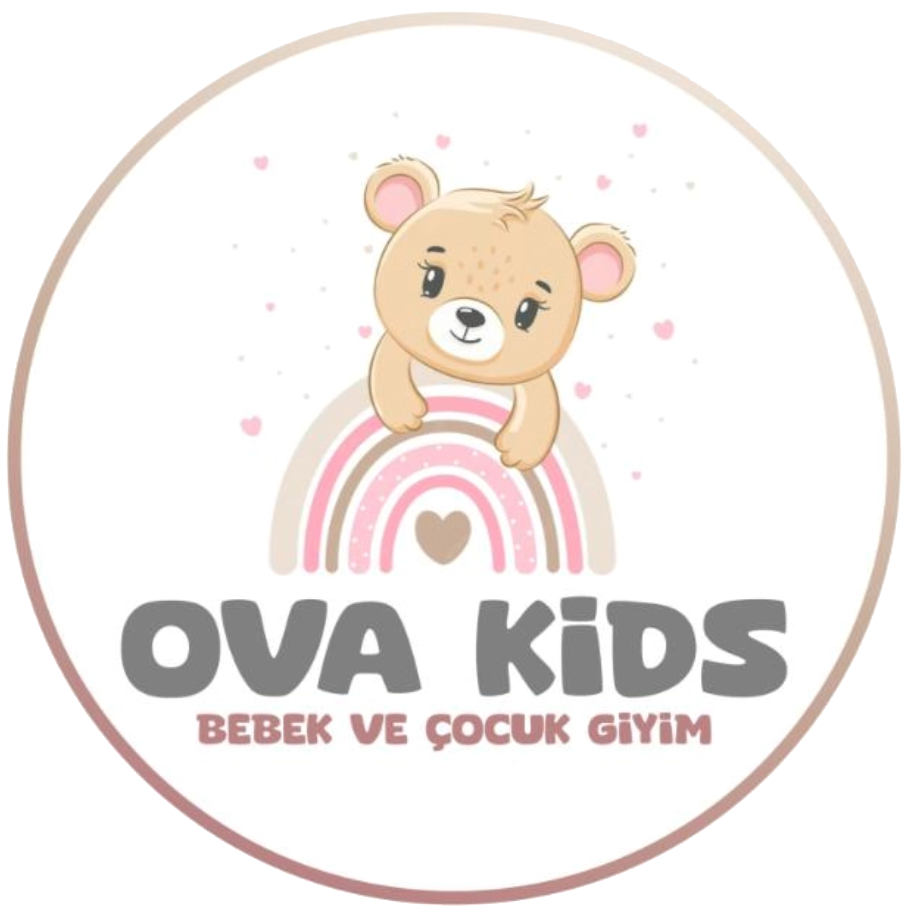
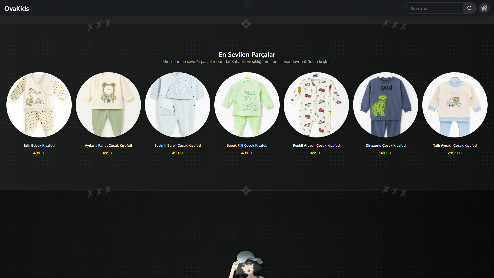
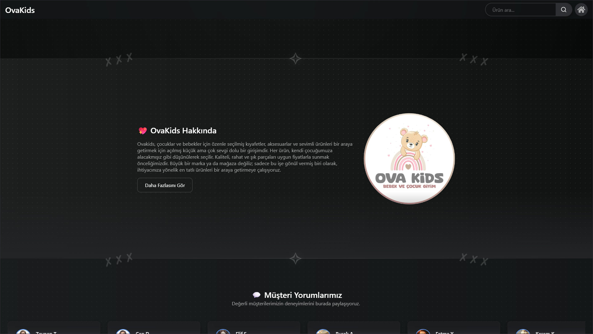
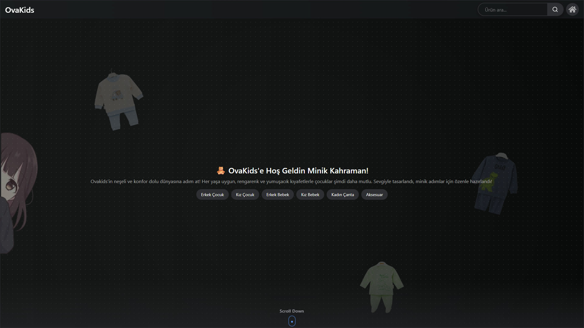
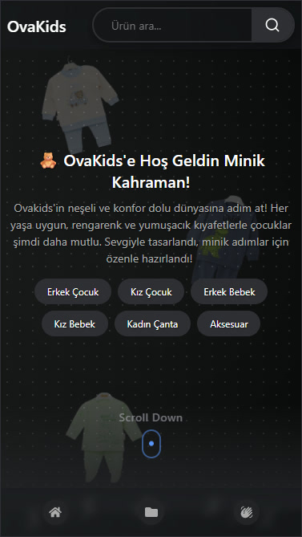
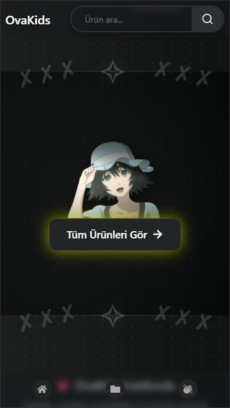

<a href="README.md">
  
</a>
<a href="README-TR.md">
  
</a>

  <br />
  <br />

<div align="center">
  
  <br />
  <br />

  <p>
     A showcase website for children's and babies' clothing and accessories.
  </p>


  <p>
    <a href="#demo">Demo</a> •
    <a href="#about">About</a> •
    <a href="#features">Features</a> •
    <a href="#tech">Tech</a> •
    <a href="#setup">Setup</a> •
    <a href="#gallery">Gallery</a> •
    <a href="#license">License</a>
  </p>

  <br />
  <br />
</div>

## <a id="demo"></a> 📷 Demo

- [https://xkintaro.github.io/ovakids/](https://xkintaro.github.io/ovakids/)

## <a id="about"></a> 📋 About

**OvaKids** is a showcase website for a store that sells clothing and accessories for children and babies. I built it in a single day as a quick demo for a neighbor's store. The project did not continue afterwards, so I am keeping it here as an archive.

The site lists featured products on the home page and lets visitors browse the whole catalog by category or by searching. Product, category and review data are read from JSON files in the `public/data` folder, so the content can be changed without touching the code. The interface is in Turkish.

## <a id="features"></a> ✨ Features

- **Featured products**: Highlighted products are shown on the home page.
- **Category filter**: Browse the catalog by categories such as boys, girls, baby boys, baby girls, women's bags and accessories.
- **Live search**: Search product titles and descriptions as you type.
- **Customer reviews**: Read customer comments with star ratings.
- **Mobile menu**: A bottom menu on small screens gives quick access to the home page, products and the about section.

## <a id="tech"></a> 🛠️ Tech

`React` · `Vite` · `CSS` · `React Icons` · `Kintaro UI`

## <a id="setup"></a> 🚀 Setup

### Requirements

- **Node.js**

### Step-by-Step Installation

1. **Clone the repository**

   ```bash
   git clone https://github.com/xkintaro/ovakids.git
   cd ovakids
   ```

2. **Install dependencies**

   ```bash
   npm install
   ```

   On Windows you can run `install-dependencies.bat` instead.

3. **Start the development server**

   ```bash
   npm run dev
   ```

   On Windows you can run `run.bat` instead.

Open the app at [http://localhost:5173/ovakids/](http://localhost:5173/ovakids/).

## <a id="gallery"></a> 🖼️ Gallery







<p align="center"></p>

## <a id="license"></a> 📄 License

This project is licensed under the MIT License. See the [LICENSE](LICENSE) file for details.

#

<p align="center">
  <sub>❤️ Developed by "Mustafa TAŞAL" (kintaro)</sub>
</p>
